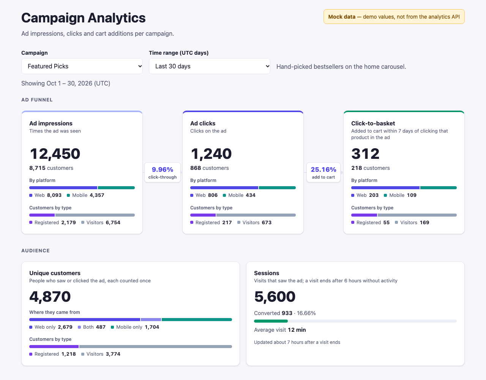

# Basketline

**Real-time ad insights for retail media: from ad click to basket.**

Basketline is a multi-tenant ads analytics platform for online retailers (tenants, e.g. a Flipkart or a Walmart) and the marketers who advertise on them:
- **Capture:** shopper and ad events as people browse, from every retailer's stores, sites and apps, in real time.
- **Attribute:** it credits each add to cart to the ad click that led to it (last click on that product within 7 days), and groups each shopper's events into sessions (30 minutes without activity ends one).
- **Integrate:** retailers add the browser SDK, [`@divya2424/basketline-sdk`](https://github.com/divya2424/basketline-sdk), to their site (`track()`, `identity()`). Their backend sends their stores, products and campaigns with the SDK's server entry (`/server`), and vouches for signed-in shoppers, with an API key.
- **Report:** for each campaign, in one store or all of them:
  - the customers who saw the ad, clicked it, and added a product to the cart after clicking (`GET /ad/{campaignId}/impressions`, `clicks`, `clickToBasket`), with the event totals behind them;
  - unique customers, and sessions that saw the ad and converted in the same session (`uniqueCustomers`, `sessions`);
  - over any date range, live.

Every retailer (tenant) is kept apart: users, campaigns, events and metrics, in every store and topic.



```
 retailer site (SDK) ──► gateway :8080 ──► ingestion-service ──► Kafka: retail.interactions.v1 (14 days), identity,
 retailer backend    ──► (auth, limits)    (validate, bot filter,  catalog, campaign and tenant topics (compacted)
  (catalog, campaigns, via /retail API)     tenant budgets)              │                        │
                                                                         ▼                        ▼
 dashboard ──► insights-service (/ad) ◄── ClickHouse ◄── serving ◄── Flink SQL            Kafka Connect ──► Iceberg on S3
                                    (daily tables per tenant,  topics   (ad events, 7-day      (every topic)      (the lake, forever)
                                     store, campaign: forever;          attribution join,                           │
                                     staging: 3 days)                   30-min sessions)     Airflow: history backfill from the lake,
                                                                                             backups, tenant and shopper purges
 Prometheus + Grafana: services (RED), Kafka lag, Flink, ClickHouse, pipeline health
```

The repo has two folders:
- **[`basketline/`](basketline/README.md): the product.** The analytics path: ingestion-service (data in), Kafka, Flink, ClickHouse, insights-service (the `/ad` API), Iceberg and Airflow; with the gateway, auth-service and the dashboard.
- **[`retailer-sim/`](retailer-sim/README.md): a simulated retailer**, so the integration can be shown end to end, through Basketline's public API only: its own sign-in (retailer-auth-service, which onboards its stores at Basketline and keeps their API keys), product- and campaign-service (its catalog and campaigns, sent to Basketline's retail API), and its storefront (tracking shoppers with the SDK).

**Design documents:**
- [Platform design](docs/platform-design.md): the design proposal: technology choices, ingestion, stateful processing (attribution, sessions), storage and retention, the insights API, scalability, monitoring, multi-tenancy, trade-offs, cost, and extending it.
- [Platform architecture](docs/platform-architecture.svg): the logical view, from the retailer's site to the `/ad` API and the lake.
- [Production deployment on AWS](docs/deployment-aws.svg): EKS node pools, MSK, Kafka Connect, ClickHouse shards and replicas, S3 + Glue + Iceberg, RDS, secrets, CI/CD, sized for 100k events/s.
- [Local architecture](docs/current-architecture.svg): what runs in Docker Compose.

## Technology choices

| Layer | Choice | Alternatives considered | Why this one |
|---|---|---|---|
| **Ingestion API** | Node.js 24 + TypeScript (Express), stateless, behind one gateway | Go or Java collectors; Kinesis or Kafka REST directly from browsers | Validation, tenant checks and token rules live in one typed codebase shared with the contracts. Each pod only validates and publishes (no state), so it scales by adding pods. A dedicated edge collector is the next step at very high volume |
| **Event stream** | Apache Kafka (MSK on AWS); shared topics per domain, keyed by event ID | Kinesis, Pulsar, Redpanda | Replays (14 days kept) rebuild every downstream copy; compacted topics keep the latest reference data per ID; Flink, ClickHouse and Airflow all read it natively. Topics per *domain*, not per tenant or event name, so retailers and event names add no topics |
| **Stream processing** | Apache Flink (SQL) | Spark Structured Streaming, Kafka Streams, ksqlDB | Large keyed state (RocksDB, checkpointed) for the 7-day click→basket join, event-time session windows with watermarks, in plain SQL. The earlier Spark loader's 30 s micro-batches left data 24–30 s behind (p50, measured), and its watermark dropped late joins. Kafka Streams has the windows too, but is a Java library with no SQL. Output is at least once; ClickHouse counts each event and session once |
| **Real-time store and API reads** | ClickHouse: daily tables updated by materialized views as Flink's output lands | Druid, Pinot, Cassandra, DynamoDB, Elasticsearch | Counts over any date range in milliseconds from pre-aggregated daily rows, with mergeable `uniqCombined64` sketches for unique customers. Cassandra and DynamoDB are key-value stores: fast lookups, but every new question needs a new table and no ad-hoc aggregation or distinct counts. Druid and Pinot fit too, with more moving parts to run |
| **Long-term and batch analytics** | Apache Iceberg on S3 (Glue catalog; JDBC locally), written by Kafka Connect's Iceberg sink from every topic | Snowflake, BigQuery, Delta Lake; raw tables in ClickHouse | Open format, cheapest storage, kept forever; any engine reads it (ClickHouse for backfills, Athena, Trino, Snowflake via external Iceberg tables). Row-level deletes for erasure. Snowflake is a fine query layer on top, not the place to land a raw stream |
| **Operational data** | Postgres, one database per service | — | Users, catalog and campaigns are small, relational and transactional |
| **Orchestration** | Airflow 3 | Step Functions, Dagster | History backfills from the lake, backups, tenant and shopper purges, with retries and history |
| **Monitoring** | Prometheus + Grafana, alerts | CloudWatch, Datadog | Open source, the same locally and on Kubernetes; every component exposes Prometheus metrics |
| **Deployment** | Kubernetes (EKS) with a Helm chart per service; Flink Kubernetes Operator at scale | ECS, managed Flink (Kinesis Data Analytics) | Each service deploys and rolls back on its own; autoscaling; the same images locally |

**Storage and retention:**

| Data | Where | Kept |
|---|---|---|
| Raw events | Kafka | 14 days (replays); reference topics compacted |
| Flink's output (ad events, attributed baskets, sessions) | Kafka serving topics, then ClickHouse staging | 48 hours, then 3 days |
| Daily campaign counts, customer and session sketches (what `/ad` reads) | ClickHouse | Forever (small) |
| Every event of every topic | Iceberg on S3 (the lake) | Forever (cheaper tiers with age) |
| ClickHouse backups | S3 | 35 days |

**Real time vs accuracy:** the dashboard is live (under a minute); totals are corrected by an hourly recount from staging (duplicates from retries or replays removed), and any settled day can be recomputed from the lake (`history_backfill`). Event counts are exact; unique customers are sketches, within about 1%. Details in [basketline/README.md § Where the metrics live](basketline/README.md#where-the-metrics-live).

## Quick start

Requires Node 24, Docker and pnpm (`corepack enable pnpm` gives you the version each project pins), and a GitHub token with `read:packages`: the Kafka event bus ([`basketline-kafka`](https://github.com/divya2424/basketline-kafka)) and the SDK come from GitHub Packages.

```bash
# Once: pnpm reads registry tokens only from your own config, not a project's.
echo '//npm.pkg.github.com/:_authToken=${NODE_AUTH_TOKEN}' >> ~/.npmrc

export NODE_AUTH_TOKEN=<GitHub token with read:packages>

pnpm install              # once, at the repo root: one workspace for both folders

# The platform: everything in "Local URLs" below
cd basketline
pnpm keys                 # JWT signing keys → basketline/keys/ (git-ignored)
docker compose up -d --build

# The simulated retailer's services: their own Postgres, on the platform's network
cd ../retailer-sim
pnpm keys                 # its own keys → retailer-sim/keys/ (git-ignored)
docker compose up -d --build

# The two web apps, each in its own terminal from the repo root
(cd basketline/dashboard && cp .env.example .env && pnpm dev)     # http://localhost:5173
(cd retailer-sim/storefront && cp .env.example .env && pnpm dev)  # http://localhost:5174
```

Without a GitHub token, `pnpm install` and the image builds fail on the two packages above (`401 Unauthorized`): create a classic token with only `read:packages`.

1. On the storefront's Stores page, http://localhost:5174/stores, connect a store. The retailer onboards it at Basketline and keeps its API key: Basketline creates an `onboarding` campaign manager and a `seller01` seller manager (password `test`); the retailer creates its logins (`staff`, `user01`–`user10`, password `test`) and sends its sample sellers, products and campaigns to Basketline.
2. **Open** it to shop; sign in as `user01` to shop as a customer.
3. On the dashboard, http://localhost:5173, click **Analytics** on the tenant's row.

To create tenants and users from the command line, see [basketline/README.md § Run it](basketline/README.md#run-it).

## Local URLs

| What | URL | Sign-in |
|---|---|---|
| **Dashboard** (Basketline) | http://localhost:5173 | Sign in from a tenant's row |
| **Storefront** (simulated retailer) | http://localhost:5174 · stores at /stores | Visitors need no sign-in; the store's logins are the retailer's |
| **API gateway** | http://localhost:8080/api/v1 | Tokens from `/auth/login` or `/auth/visitor` |
| Gateway health | http://localhost:8080/health/ready | — |
| **Flink** web UI | http://localhost:8081 | — |
| **Kafka Connect** REST | http://localhost:8083/connectors/lake-sink/status | — |
| **Airflow** UI | http://localhost:8082 | None (local only) |
| **ClickHouse** SQL console | http://localhost:8123/play | `basketline` / `basketline_dev` |
| **S3: the lake, backups** (SeaweedFS) UI · S3 API | http://localhost:23646 · http://localhost:8333 | `archive` / `archive_dev` |
| **Kafka** | `localhost:9092` | — |
| **Postgres** | `localhost:5432` | `postgres` / `postgres` |
| **Grafana** (`docker compose --profile monitoring up -d`) | http://localhost:3000 (dashboard "Pipeline") | Viewing: none; editing `admin` / `basketline_dev` |
| **Prometheus** (same profile) | http://localhost:9090 · alerts http://localhost:9090/alerts | — |

Basketline's services (auth 4001, ingestion 4004, insights 4005) are reached only through the gateway. The simulated retailer's (sign-in 4006, products 4002, campaigns 4003) are published on 127.0.0.1 for its storefront, with their own Postgres on port 5433. See [basketline/README.md § Services and URLs](basketline/README.md#services-and-urls) for each service and its health probe. These are development credentials, for local use only.

**Docker.** The platform runs as the Compose project `basketline`, the simulated retailer's services as `retailer-sim` (on the platform's network):

| | Named |
|---|---|
| Containers | `basketline-<service>-1`, e.g. `basketline-gateway-1`; `retailer-sim-<service>-1`, e.g. `retailer-sim-retailer-auth-service-1` |
| Images | `basketline-<service>`, `retailer-sim-<service>` |
| Volumes | `basketline_pgdata`, `basketline_chdata`, `basketline_flink-checkpoints`, `basketline_archive-data`; `retailer-sim_retailer-pgdata` |

```bash
cd basketline              # or retailer-sim, for its services
docker compose ps                      # every container and its health
docker compose logs -f gateway         # one service's logs
docker compose down                    # stop (volumes kept); add -v to delete the data too
```

## Repository layout

| Folder | What it is | Docs |
|---|---|---|
| [`basketline/`](basketline/) | **The product:** the gateway and four services, Kafka contracts, Postgres and ClickHouse schemas | [basketline/README.md](basketline/README.md) |
| [`basketline/dashboard/`](basketline/dashboard/) | The tenants and the campaign dashboard (React 19, Vite) | [dashboard/README.md](basketline/dashboard/README.md) |
| [`basketline/flink/`](basketline/flink/) | The Flink SQL job: ad events, click→basket attribution, sessions | [flink/README.md](basketline/flink/README.md) |
| [`basketline/connect/`](basketline/connect/) | Kafka Connect with the Iceberg sink: every topic into the lake | [basketline/README.md](basketline/README.md) |
| [`basketline/airflow/`](basketline/airflow/) | The history backfill from the lake, ClickHouse backups, tenant and shopper purges | [airflow/README.md](basketline/airflow/README.md) |
| [`basketline/infra/monitoring/`](basketline/infra/monitoring/) | Prometheus scrape config and alerts, the Grafana "Pipeline" dashboard, Loki and Alloy | [basketline/README.md § Monitoring](basketline/README.md#monitoring) |
| [`basketline/loadtest/`](basketline/loadtest/) | The k6 load test for the analytics path | [loadtest/README.md](basketline/loadtest/README.md) |
| [`basketline/deploy/helm/`](basketline/deploy/helm/) | Kubernetes: a Helm chart per service, helmfile | [helm/README.md](basketline/deploy/helm/README.md) |
| [`retailer-sim/`](retailer-sim/) | **The simulated retailer:** its sign-in, product- and campaign-service, their Compose file and Helm charts | [retailer-sim/README.md](retailer-sim/README.md) |
| [`retailer-sim/storefront/`](retailer-sim/storefront/) | The retailer's web shop and Stores page, tracking with the Basketline SDK (React 19, Vite) | [storefront/README.md](retailer-sim/storefront/README.md) |

The root holds the one pnpm workspace (`pnpm-workspace.yaml`, the lockfile and the backend's shared dependencies) and the `Dockerfile` that builds every Node service.

## Tests

| Command | Covers | Needs |
|---|---|---|
| `cd basketline/dashboard && pnpm test` | The dashboard | Nothing |
| `cd retailer-sim/storefront && pnpm test` | The storefront | Nothing |
| `cd basketline && pnpm verify` | Typecheck, architecture check (both folders), unit and integration tests | postgres, kafka, clickhouse |
| `cd retailer-sim && pnpm verify` | The simulated retailer's services | postgres, kafka |
| `cd basketline && pnpm test:e2e` | The full flow through the gateway, with real Kafka | The whole stack |
| `cd basketline && pnpm test:flink` | Click→basket attribution through Kafka → Flink → ClickHouse | The whole stack |
| `cd basketline && pnpm test:airflow` | The history backfill (events, attribution, sessions, rollback) and the lake purge | The stack, and [uv](https://docs.astral.sh/uv/) |
