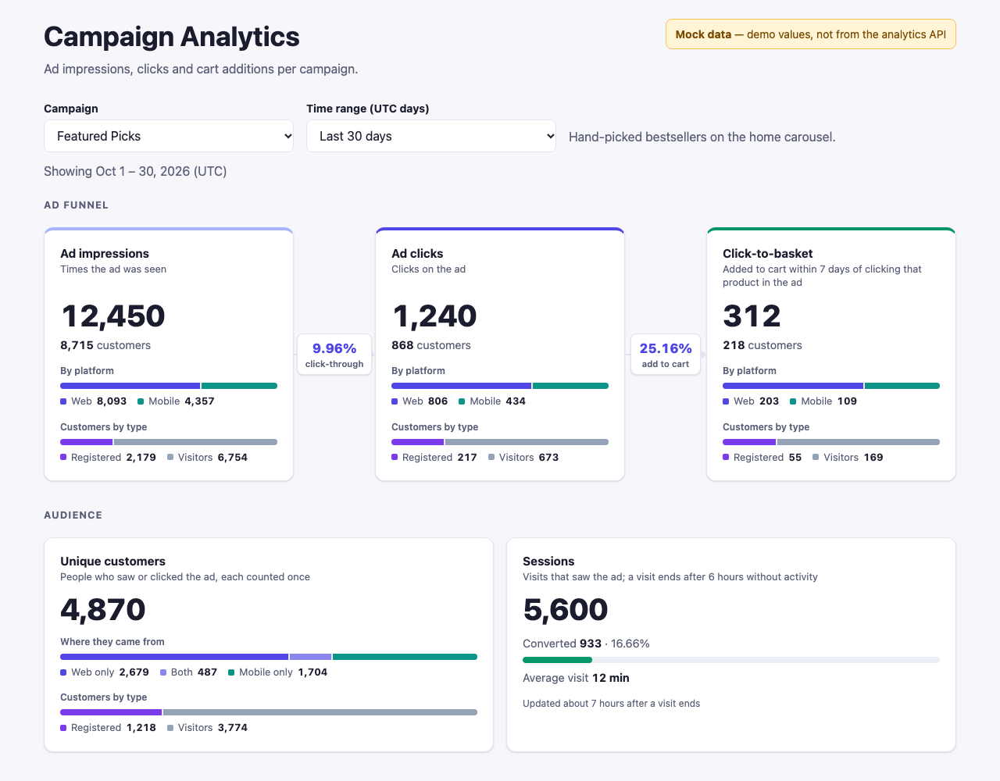
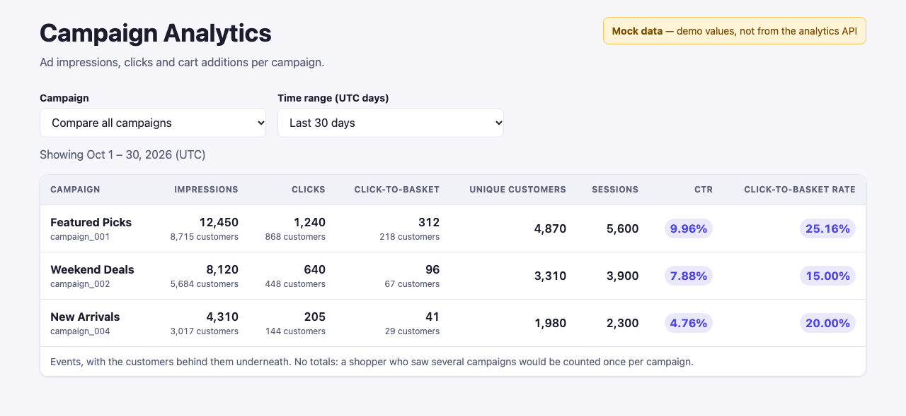

# Basketline: dashboard

Basketline's web app, a React + Vite app on the platform's gateway (`..`):

- **Tenants page:** every tenant, with its dashboard, its API keys, and its store in the simulated retailer's storefront (`../../retailer-sim/storefront`). Retailers onboard with Basketline's API (`POST /accounts`); the simulated retailer does it from its storefront's Stores page.
- **Sign-in:** against the auth service, with roles.
- **Campaign dashboard:** for campaign managers, per store or across stores, with the ad funnel, the audience and sessions.
- **Integration:** each tenant's SDK setup and API keys.



## Quick start

Requirements: Node.js 20.19+ (developed on Node 24) and pnpm (`corepack enable pnpm`), with the platform running locally (`../README.md`). Dependencies are installed once for the whole repo, from its root (`pnpm install`).

```bash
cd basketline/dashboard
cp .env.example .env         # points at the gateway on http://localhost:8080/api/v1
pnpm dev                     # http://localhost:5173
```

Connect a store on the storefront's Stores page (http://localhost:5174/stores, see `../../retailer-sim/README.md`), then on http://localhost:5173 click **Analytics** on its row. You're signed in as its `onboarding` campaign manager (password `test`), with the store's campaigns, which its services sent through the retail API. **Open store** opens the tenant's store in the storefront.

| Command | |
|---|---|
| `pnpm dev` | Development server on http://localhost:5173 (the gateway allows CORS from here) |
| `pnpm test` | Vitest + React Testing Library. No backend needed |
| `pnpm build` | Production build into `dist/` |

<details>
<summary>Using the default tenant from the CLI instead</summary>

```bash
cd basketline
docker compose exec auth-service node basketline/services/auth-service/src/cli.ts \
  create-account --name 'Default storefront' --tenant 5e0f3c2a-8b14-4d6f-9a27-1c3e5b7d9f01
docker compose exec auth-service node basketline/services/auth-service/src/cli.ts \
  create-user --username maya --password 'correct horse battery' --role campaign-manager \
  --tenant 5e0f3c2a-8b14-4d6f-9a27-1c3e5b7d9f01
docker compose exec auth-service node basketline/services/auth-service/src/cli.ts \
  create-api-key --name 'Sample feed' --tenant 5e0f3c2a-8b14-4d6f-9a27-1c3e5b7d9f01
SEED_API_KEY=<the key> pnpm seed    # 10 sample products and 4 campaigns, through the retail API
```

A tenant created this way has no `onboarding` user, so use **Log in** on its row and sign in as `maya`.
</details>

## Configuration

Set these in `.env`, starting from `.env.example`.

| Variable | Values | Purpose |
|---|---|---|
| `VITE_API_BASE_URL` | URL | The API gateway, e.g. `http://localhost:8080/api/v1`. Every API call goes here. |
| `VITE_ANALYTICS_MODE` | `live` \| `mock` | `live` reads dashboard metrics from the API. `mock` shows demo numbers for any campaign, labelled **Mock data**. |
| `VITE_TENANT_ID` | UUID | The default tenant, sent as the `tenant_id` header. Defaults to `5e0f3c2a-8b14-4d6f-9a27-1c3e5b7d9f01`. A tenant picked on the tenants page takes precedence. |
| `VITE_STOREFRONT_URL` | URL | The storefront that **Open store** and the Stores link open. Defaults to `http://localhost:5174`. |

## Using the app

### Tenants

The app opens on the tenants page (`/`), open to everyone.

- **Onboarding** is the retailer's: its backend calls `POST /accounts` (a name and a tier) and keeps the first **API key** from the answer. Every tenant gets an `onboarding` campaign manager, with the password `test`. The simulated retailer onboards from its storefront's Stores page.
- **Tenants list:** every tenant, newest first. Each row has:
  - **Open store:** opens the storefront on that tenant (`/store?tenant=<id>&name=<name>`), as a visitor;
  - **Analytics:** signs in as the tenant's `onboarding` user and opens `/analytics`;
  - **Log in:** sign in as any of its users, then open its dashboard;
  - **Details:** the tenant's SDK setup and its **API keys** (list, create, revoke), loaded by signing in as its `onboarding` manager for that panel only, so the app stays on its current tenant. A tenant created with the CLI has no `onboarding` user; manage its keys with the CLI. Details also has **Delete tenant**: type the tenant's name to confirm, and it and all of its data are deleted for good (see `../README.md`, "Deleting a tenant"). Deleting the tenant you're in signs you out.

`/analytics` requires signing in to that tenant. Signed out, it redirects to `/`. The chosen tenant is remembered in `localStorage` (`basketline:tenant`).

**Header:** inside a tenant it shows the tenant's name, Analytics for campaign managers, the user and **Logout** (back to the tenants page).

### Sign-in and roles

| | |
|---|---|
| **Session** | Kept in `sessionStorage` (`basketline:session:v3`: profile, role, token and expiry, tenant; never the password), so it lasts until the tab closes. Switching tenants means signing in again. |
| **Expiry** | The token lasts 30 minutes, then the app signs out. |
| **Logout** | Ends the session on the server too. |
| **Roles** | Only `campaign-manager` users see **Analytics**. Anyone else opening `/analytics` sees "Access restricted", and the dashboard code is never downloaded. The API enforces the role on every request regardless. |

> **Security note:** any script on the page can read `sessionStorage`, so the app must stay free of XSS. An `httpOnly` cookie would avoid this, but needs backend support.

## Campaign dashboard

`/analytics` (`src/features/analytics`) shows one campaign, or **Compare all campaigns** as a table.

| Section | Cards |
|---|---|
| **Ad funnel** | **Ad impressions → Ad clicks → Click-to-basket.** Each card shows the event count, the customers behind it, a web/mobile split and a registered/visitors split. The conversion rate between two steps sits on the arrow between them: CTR, then click-to-basket rate. |
| **Audience** | **Unique customers:** the people who saw or clicked the ad, split into web only / both / mobile only, and registered / visitors. **Sessions:** visits that saw or clicked the ad, how many converted (added a product they clicked in the ad to the cart in the same visit), and web/mobile. |



The screenshots use mock data (`VITE_ANALYTICS_MODE=mock`).

**What the numbers mean**

- **Counts and customers:**
  - impressions, clicks and click-to-basket are **event counts**;
  - their **customers** are the people behind them, each counted once over the range;
  - customer and session counts are estimates, within about 1% beyond a few thousand.
- **Click-to-basket:** an add to cart of a product within 7 days of clicking that product in the ad. The latest click gets the credit. The backend works this out, not the browser.
- **Rates:**
  - **CTR** = clicks ÷ impressions × 100;
  - **click-to-basket rate** = click-to-basket ÷ clicks × 100;
  - both are shown with 2 decimals, or `—` when the divisor is 0.
- **Overlaps:** someone on both web and mobile counts once in the total. A visitor who later registered counts as both registered and visitor, and once in the total.
- **Sessions:** a visit ends after 30 minutes without activity. Session numbers arrive about 40 minutes after a visit ends.

**Time range.**
- **Options:** the last 7, 30 (the default) or 90 days, the last year, or a custom range of up to 366 days.
- **UTC days:** days are UTC, like the backend's daily totals, and the line under the toolbar shows exactly which days are counted.
- **What's sent:** a preset sends only `from`, so today counts up to now; a custom range also sends `to`.
- **Code:** see `timeRange.js`.

**Freshness:** counts are fetched again every 20 seconds while the page is visible, without a loader. With the backend's batching and 15-second cache, they are at most about a minute old.

**Integrate your site:** a closed section at the bottom of the dashboard, loaded only when opened. It has two parts:
- the SDK setup snippet, with the store's tenant ID;
- the store's API keys: create one (shown once, with a Copy button), see when each was created, and revoke one.

The code is in `src/features/integration`.

**Loading and errors:** each card loads on its own, with placeholders shaped like the card, and a status chip in the section header shows progress. A card that fails shows **Retry**, without hiding the others.

## How it talks to the backend

Every request goes through `apiRequest()` (`src/api/httpClient.js`), one [axios](https://axios-http.com) instance using the fetch adapter. It:
- adds the `tenant_id` header, plus `user_id` and `Authorization: Bearer <token>` when signed in;
- parses JSON;
- turns `{ error: { code, message } }` responses into an `ApiError`;
- signs the user out when a signed-in request gets a 401 (an expired or revoked session).

| Feature | API calls |
|---|---|
| Tenants | `GET /accounts`, `DELETE /accounts/{tenantId}` |
| Sign-in | `POST /auth/login` (`clientType: "web"`), `POST /auth/logout` |
| Campaign list | `GET /ad/campaigns` (the tenant's campaigns with activity, per store), once per sign-in |
| Dashboard | `GET /ad/{campaignId}/impressions \| clicks \| clickToBasket \| uniqueCustomers \| sessions?from&to&storeId` |
| Integration | `GET\|POST\|DELETE /auth/api-keys`, `GET\|PUT /auth/allowed-origins` |

## Project layout

```
src/
  api/                    httpClient (apiRequest, ApiError), requestContext (tenant, user, token)
  app/                    app shell and routes
  components/             layout (Header, Footer) and common (Button, Toast, Spinner)
  features/onboarding/    the tenants page: tenant list and details
  features/analytics/     the dashboard (MetricCard, CampaignMetricsPanel, CampaignComparison) and the /ad client
  features/integration/   SDK snippet, API keys, allowed websites
  features/catalog/       CatalogProvider: the signed-in tenant's campaigns from the API
  features/auth/          sign-in, session, LoginModal, RequireRole, RequireTenant
```

**Testing:** the tests render the app with a sample catalog (`src/test/campaignData.js`: a copy of the storefront's sample campaigns), and `mockFetch()` (`src/test/mockFetch.js`) answers API calls, so they need no backend.

**StrictMode:** in development, React mounts each component twice. Pending data requests are shared (`src/api/sharedRequest.js`) rather than cancelled on unmount, so each is sent once.
