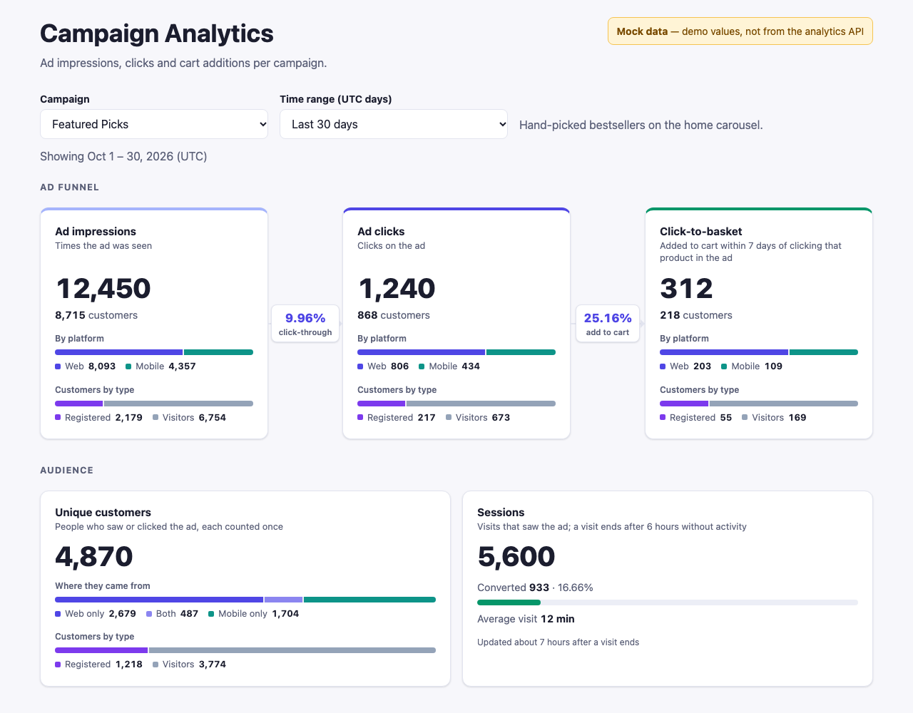
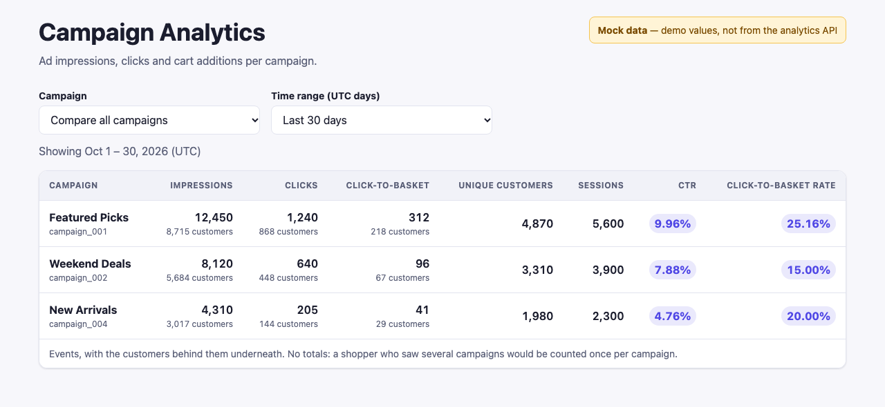

# Basketline: frontend

The web app of [Basketline](../README.md), a React + Vite app on the Basketline backend (`../backend`):

- **Onboarding page:** create tenants and open their stores.
- **Storefront:** a catalog and campaign carousel from the API, product pages and a cart.
- **Sign-in:** against the auth service, with roles.
- **Analytics events:** sent to the analytics service as shoppers browse.
- **Campaign dashboard:** for campaign managers, with the ad funnel, the audience and sessions.



## Quick start

Requirements: Node.js 20.19+ (developed on Node 24) and npm, with the backend running locally (`../backend/README.md`).

```bash
# 1. Backend: start everything
cd backend
npm install && npm run keys
docker compose up -d --build

# 2. Frontend
cd ../frontend
npm install
cp .env.example .env         # points at the gateway on http://localhost:8080/api/v1
npm run dev                  # http://localhost:5173
```

On http://localhost:5173, onboard a tenant, then click **Analytics** on its row. You're signed in as its `onboarding` campaign manager (password `test`), with demo products and campaigns already seeded.

| Command | |
|---|---|
| `npm run dev` | Development server on http://localhost:5173 (the gateway allows CORS from here) |
| `npm test` | Vitest + React Testing Library. No backend needed |
| `npm run build` | Production build into `dist/` |

<details>
<summary>Using the default tenant from the CLI instead</summary>

```bash
cd backend
docker compose exec auth-service node services/auth-service/src/cli.ts \
  create-account --name 'Default storefront' --tenant 5e0f3c2a-8b14-4d6f-9a27-1c3e5b7d9f01
docker compose exec auth-service node services/auth-service/src/cli.ts \
  create-user --username maya --password 'correct horse battery' --role campaign-manager \
  --tenant 5e0f3c2a-8b14-4d6f-9a27-1c3e5b7d9f01
npm run seed                 # 10 sample products and 4 campaigns in that tenant
```

A tenant created this way has no `onboarding` user, so use **Log in** on its row and sign in as `maya`.
</details>

## Configuration

Set these in `.env`, starting from `.env.example`.

| Variable | Values | Purpose |
|---|---|---|
| `VITE_API_BASE_URL` | URL | The API gateway, e.g. `http://localhost:8080/api/v1`. Every API call goes here, and analytics events are only sent when it's set. |
| `VITE_ANALYTICS_MODE` | `live` \| `mock` | `live` reads dashboard metrics from the API. `mock` shows demo numbers for any campaign, labelled **Mock data**. |
| `VITE_TENANT_ID` | UUID | The default tenant, sent as the `tenant_id` header. Defaults to `5e0f3c2a-8b14-4d6f-9a27-1c3e5b7d9f01`. A tenant picked on the onboarding page takes precedence. |

## Using the app

### Onboarding and tenants

The app opens on the onboarding page (`/`), open to everyone.

- **Onboard a tenant:** give it a name and a tier (Free, Pro or Enterprise), and optionally tick "Create 10 demo users". The backend generates the tenant ID and creates:
  - an `onboarding` campaign manager;
  - `user01`–`user10` (standard users), if ticked. Every one of them has the password `test`.
  - 10–15 sample products and 2 active campaigns. They appear in its store within a few seconds.
- **Tenants list:** every tenant, newest first. Each row has:
  - **Open store** and **Analytics:** sign in as the tenant's `onboarding` user and open `/store` or `/analytics`;
  - **Log in:** sign in as any of its users, then open its store.

The tenant's pages (`/store`, `/store/products/:id`, `/cart`, `/analytics`) require signing in to that tenant. Signed out, they redirect to `/`. The chosen tenant is remembered in `localStorage` (`basketline:tenant`), and each store has its own cart.

**Header:** inside a tenant it shows:
- the tenant's name;
- Home, and Analytics for campaign managers;
- the user, **Logout** (back to the onboarding page) and the cart.

### Sign-in and roles

| | |
|---|---|
| **Session** | Kept in `sessionStorage` (`basketline:session:v3`: profile, role, token and expiry, tenant; never the password), so it lasts until the tab closes. Switching stores means signing in again. |
| **Expiry** | The token lasts 30 minutes, then the app signs out. |
| **Logout** | Ends the session on the server too. |
| **Roles** | Only `campaign-manager` users see **Analytics**. Anyone else opening `/analytics` sees "Access restricted", and the dashboard code is never downloaded. The API enforces the role on every request regardless. |

> **Security note:** any script on the page can read `sessionStorage`, so the app must stay free of XSS. An `httpOnly` cookie would avoid this, but needs backend support.

## Campaign dashboard

`/analytics` (`src/features/analytics`) shows one campaign, or **Compare all campaigns** as a table.

| Section | Cards |
|---|---|
| **Ad funnel** | **Ad impressions → Ad clicks → Click-to-basket.** Each card shows the event count, the customers behind it, a web/mobile split and a registered/visitors split. The conversion rate between two steps sits on the arrow between them: CTR, then click-to-basket rate. |
| **Audience** | **Unique customers:** the people who saw or clicked the ad, split into web only / both / mobile only, and registered / visitors. **Sessions:** visits that saw the ad, how many converted, and the average visit. |



The screenshots use mock data (`VITE_ANALYTICS_MODE=mock`).

**What the numbers mean**

- **Counts and customers:**
  - impressions, clicks and click-to-basket are **event counts**;
  - their **customers** are the people behind them, each counted once over the range;
  - customer and session counts are estimates, within about 1% beyond a few thousand.
- **Click-to-basket:** an add to cart of a product within 7 days of clicking that product in the ad. The latest click gets the credit. The backend works this out, not the browser.
- **Rates:**
  - **CTR** = clicks ÷ impressions × 100;
  - **click-to-basket rate** = click-to-basket ÷ clicks × 100;
  - both are shown with 2 decimals, or `—` when the divisor is 0.
- **Overlaps:** someone on both web and mobile counts once in the total. A visitor who later registered counts as both registered and visitor, and once in the total.
- **Sessions:** a visit ends after 6 hours without activity. Session numbers arrive about 7 hours after a visit ends.

**Time range.**
- **Options:** the last 7, 30 (the default) or 90 days, the last year, or a custom range of up to 366 days.
- **UTC days:** days are UTC, like the backend's daily totals, and the line under the toolbar shows exactly which days are counted.
- **What's sent:** a preset sends only `from`, so today counts up to now; a custom range also sends `to`.
- **Code:** see `timeRange.js`.

**Freshness:** counts are fetched again every 20 seconds while the page is visible, without a loader. With the backend's batching and 15-second cache, they are at most about a minute old.

**Loading and errors:** each card loads on its own, with placeholders shaped like the card, and a status chip in the section header shows progress. A card that fails shows **Retry**, without hiding the others.

## Analytics events

Components call `trackEvent()` (or `track()` from `useAnalytics()` inside an `<AnalyticsWrapper>`). Every event is also kept in the browser: run `__basketline.getEvents()` in the console.

| Event | Emitted when |
|---|---|
| `home_view` | Once per home page visit |
| `campaign_impression` | A carousel slide is at least 50% visible (one per campaign on it) |
| `campaign_navigation` | The user changes slide |
| `product_click` | A product card is clicked, opening the product page |
| `add_to_cart` | Add to cart on a catalog card (`source: catalog_grid`) or the product page (`featureName: product_detail`) |
| `cart_view`, `cart_quantity_update`, `remove_from_cart` | Cart page activity |
| `login_click` | The sign-in dialog opens |

**Sending to the backend.** When `VITE_API_BASE_URL` is set, events are batched to `POST /analytics/events` (`src/analytics/backendTransport.js`). The campaign metrics count:

| Shopper action | Sent as |
|---|---|
| A campaign's slide becomes visible | `impression` (instead of `campaign_impression`) |
| A campaign card in the carousel is clicked | `click`, with its product |
| Add to cart | `add_to_cart`, with its product. The backend credits it to an earlier ad click; the browser keeps no record of clicks. |

Add to cart is never an ad click itself, even on a campaign card. Sending never blocks or breaks shopping: failures are logged and dropped.

**Who sent them.** Each batch carries `tenantId`, `userId` and `userType`:

| | `userId` | `userType` | Token |
|---|---|---|---|
| Signed in | the user's ID | `registered` | the user's access token |
| Visitor | this browser's UUID for the store (localStorage `basketline:anonymous-id:<tenant>`, or one per page if storage is blocked) | `visitor` | a visitor token for that UUID (`POST /auth/visitor`, `clientType: web`) |

The backend rejects a batch whose identity doesn't match its token.

## How it talks to the backend

Every request goes through `apiRequest()` (`src/api/httpClient.js`), one [axios](https://axios-http.com) instance using the fetch adapter, so events can use `keepalive`. It:
- adds the `tenant_id` header, plus `user_id` and `Authorization: Bearer <token>` when signed in;
- parses JSON;
- turns `{ error: { code, message } }` responses into an `ApiError`;
- signs the user out when a signed-in request gets a 401 (an expired or revoked session).

| Feature | API calls |
|---|---|
| Catalog | `GET /products?limit=100` and `GET /campaigns?status=active&limit=100`, once per page load. Public, so visitors can browse signed out. |
| Sign-in | `POST /auth/login` (`clientType: "web"`), `POST /auth/logout` |
| Dashboard | `GET /ad/{campaignId}/impressions \| clicks \| clickToBasket \| uniqueCustomers \| sessions?from&to` |
| Events | `POST /auth/visitor`, `POST /analytics/events` |

The store loads up to 100 products and 100 campaigns, so no pagination is needed. The carousel (`buildCarouselItems()` in `src/features/campaigns/carouselItems.js`):
- interleaves the active campaigns' products (the 1st of each, then the 2nd, …) in slides of 3;
- tags each card with its campaign;
- shows a product listed in several campaigns once.

## Project layout

```
src/
  api/                httpClient (apiRequest, ApiError), requestContext (tenant, user, token)
  app/                app shell and routes
  analytics/          trackEvent, event schema, transports (local + backend)
  components/         layout (Header, Footer) and common (Button, Toast, Spinner, AnalyticsWrapper)
  features/catalog/   CatalogProvider: products + active campaigns from the API
  features/products/  ProductCard, ProductGrid; productData.js = sample data
  features/campaigns/ CampaignCarousel; campaignData.js = sample data
  features/cart/      CartContext, CartPage (saved in localStorage: basketline:cart:v2)
  features/analytics/ the dashboard (MetricCard, CampaignMetricsPanel, CampaignComparison) and the /ad client
  features/auth/      sign-in, session, LoginModal, RequireRole
  pages/HomePage.jsx
```

**Testing:** the tests render the app with the sample catalog, and `mockFetch()` (`src/test/mockFetch.js`) answers API calls, so they need no backend. `productData.js` and `campaignData.js` are only test fixtures and the source of the backend's `npm run seed`; the app itself loads everything from the API.

**StrictMode:** in development, React mounts each component twice. Pending data requests are shared (`src/api/sharedRequest.js`) rather than cancelled on unmount, so each is sent once.
